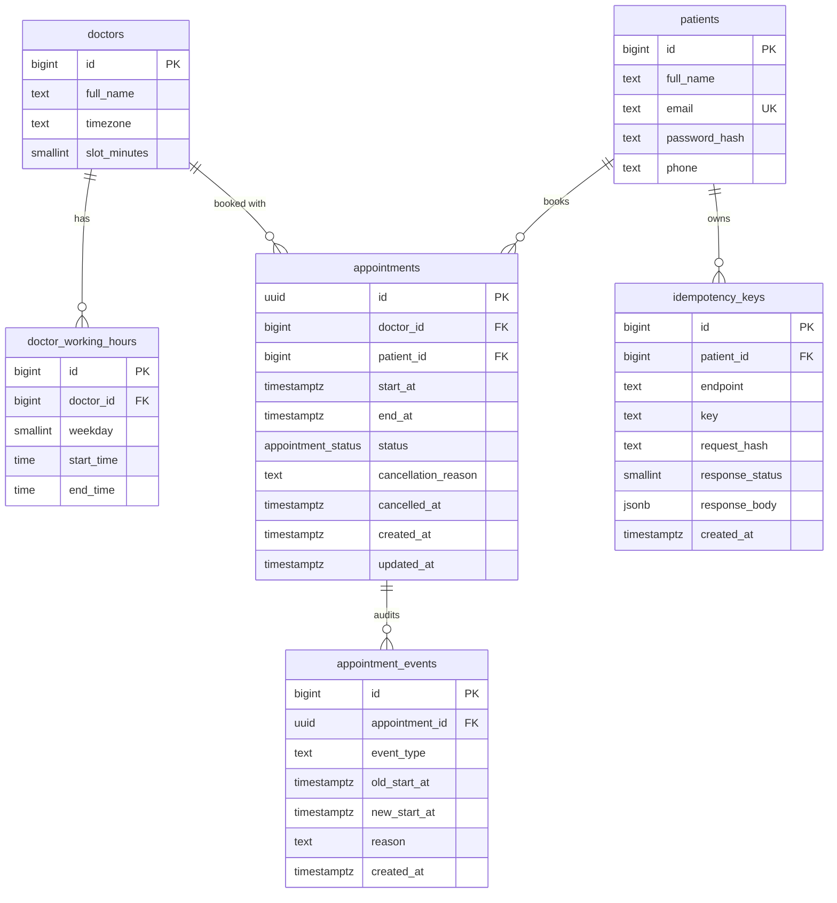
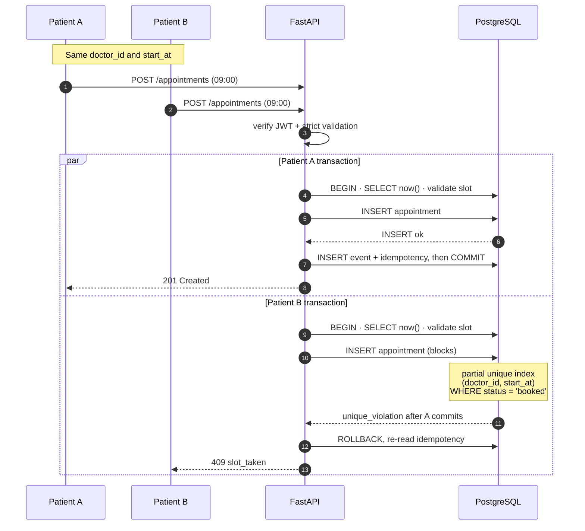
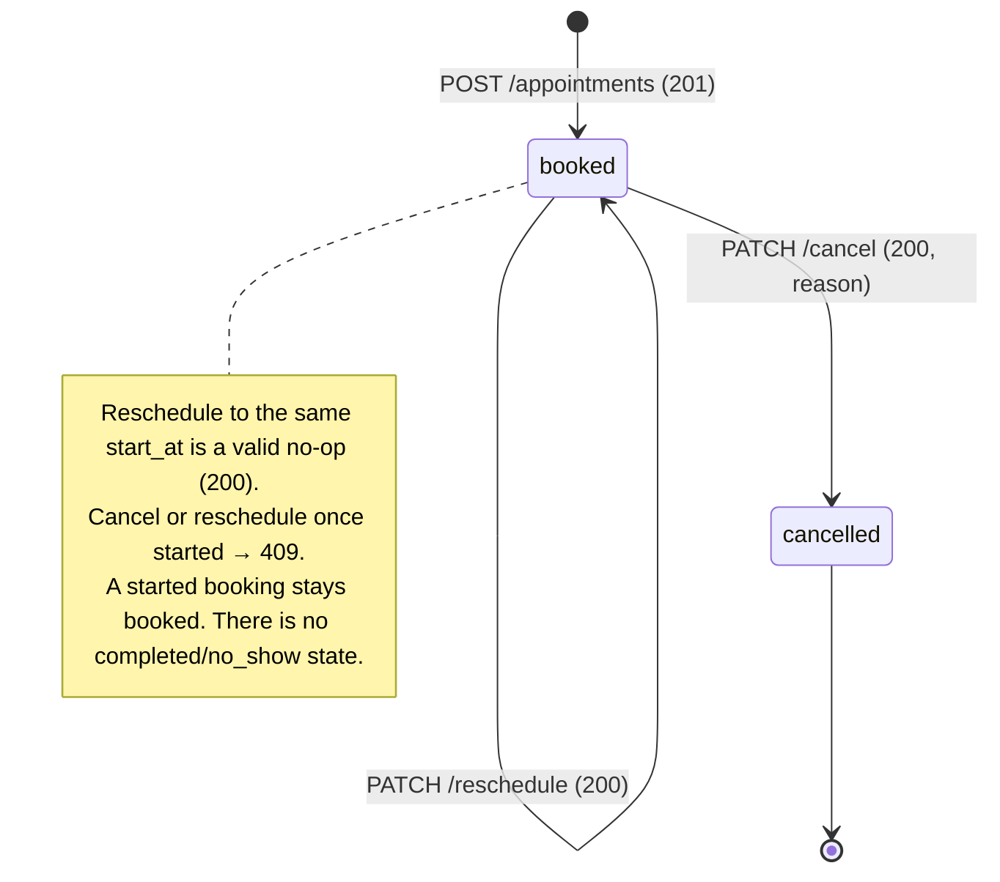
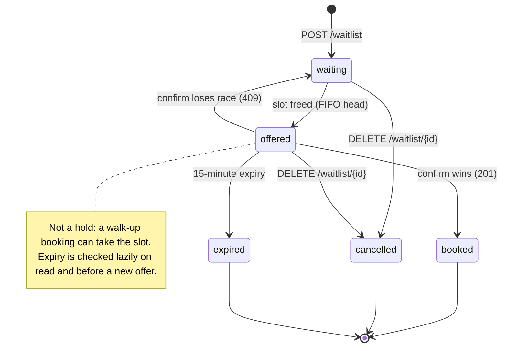
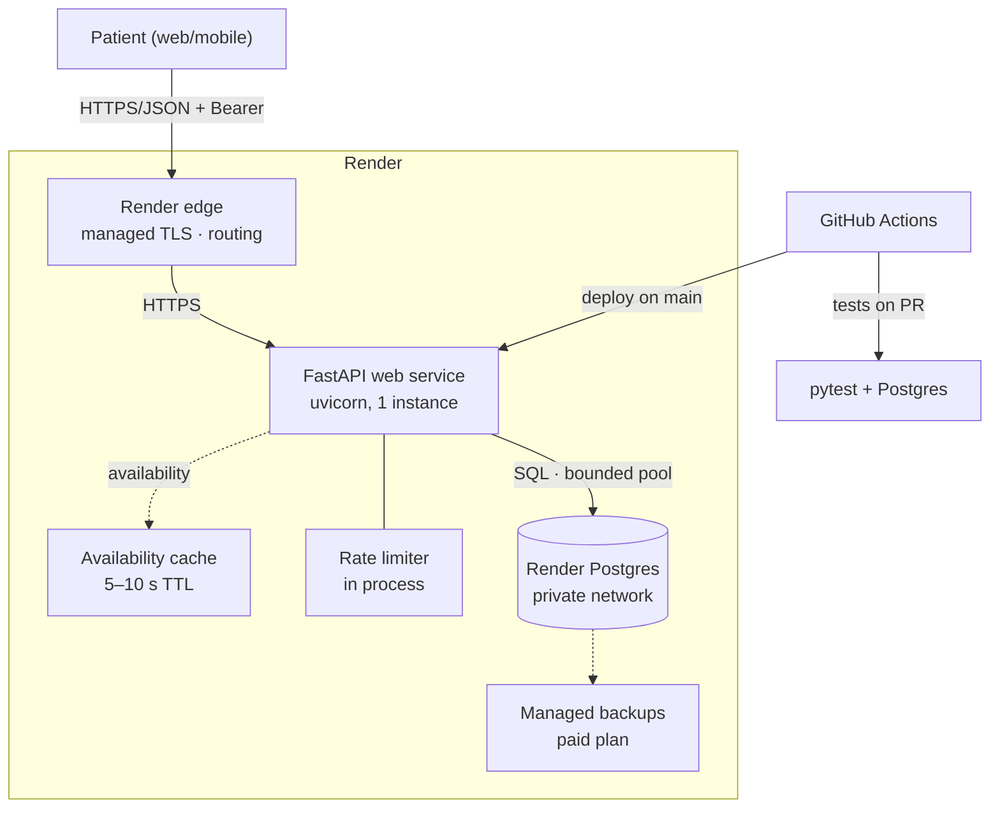
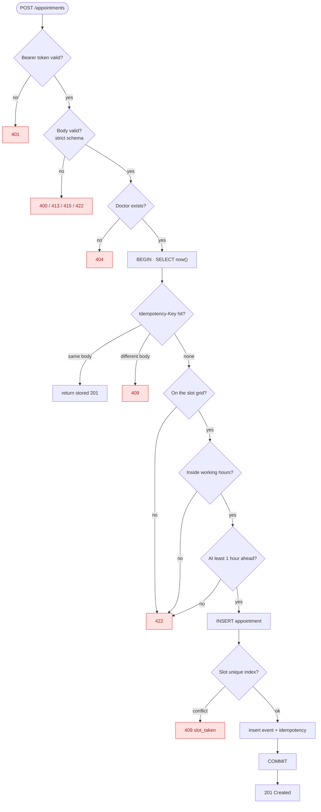

# Diagrams

Back to the [README](../README.md). These are the visual companions to the
[data model](data-model.md), [low-level design](low-level-design.md), and
[high-level design](high-level-design.md). The diagrams are Mermaid; GitHub
renders them automatically. The waitlist lifecycle is included because the design
is retained in [Future extensions](future-extensions.md), even though it is
deferred.

## 1. ERD (implemented schema)

The current build has six tables. The waitlist is intentionally absent; its
deferred schema is in [Future extensions](future-extensions.md#schema).

The booking invariant lives in the partial unique index, not in the diagram:
`one_active_booking_per_slot` on `(doctor_id, start_at) WHERE status = 'booked'`.
`appointment_status` is the enum `('booked', 'cancelled')`.

## 2. Two patients race for one slot

This is the central concurrency story. Both requests validate successfully; the
database partial unique index serializes the conflicting inserts. The winner
commits a `201`; the loser sees a unique violation after the winner commits and
returns `409 slot_taken`.

No application-level check-then-insert is used, so there is no TOCTOU window:
the index is the arbiter even across app workers and instances.

## 3. Appointment state

The implemented states are only `booked` and `cancelled`. Reschedule is a
self-transition on `booked`. A started appointment cannot be cancelled or
rescheduled.

`appointment_events` records created, cancelled, and rescheduled transitions;
a same-slot reschedule is a no-op and writes no audit row.

## 4. Waitlist entry state (deferred)

Designed in [Future extensions](future-extensions.md), not built. An offer is a
right of first refusal, not a hold: the slot stays bookable, so confirm can lose
the race and the entry returns to `waiting`.

## 5. Component diagram

The Render deployment: managed edge and database, with the app owning validation,
rate limiting, and migrations.

Render manages TLS and the public URL; Postgres is not publicly reachable. Rate
limits run in the app because Render has no built-in edge limiter. See
[Deployment](deployment.md).

## 6. Booking validation order

Every request follows this order. Any failure after `BEGIN` rolls back; no
partial writes survive.

The 1-hour window check is the bonus rule and also rejects past slots. Without
it, the predicate is `start_at > now()`.
